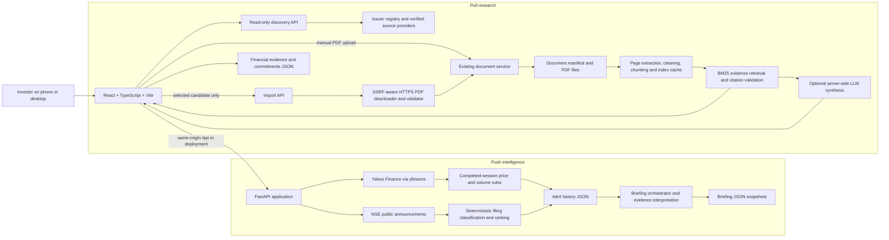

# FINN — AI Investment Intelligence

FINN is a mobile-first investment intelligence prototype for Indian listed companies. It combines **Push** monitoring (company filings and market signals) with **Pull** research (questions answered from selected primary-source documents). Its central design rule is evidence first: unavailable data stays unavailable, interpretations are distinguished from facts, and research claims link to source documents and pages where supported.

> **Prototype notice:** FINN is an engineering demonstration, not investment advice, a broker, or a production portfolio-accounting service. Market data may be delayed or incomplete. Do not enter confidential account credentials or rely on it to make trades.

## Submission links

- **Responsive web application:** [FINN on Render](https://finn-ai-bhj4.onrender.com/) *(deployment was previously shared for this project; verify it is awake and current before submitting)*
- **Source repository:** [github.com/mukeshsiyol/Finn.Ai](https://github.com/mukeshsiyol/Finn.Ai). Verify GitHub reflects the final local commit before sharing it; local README changes are not automatically pushed.
- **AI build history:** include the Codex/LLM conversation export or share links required by the brief. The conversation history is separate from this repository; this README does not contain it.
- **Submission email:** send links and attachments to `assessment@enam.com` with subject **IIT Delhi – AI Engineer – 2027**. A concise cover-note outline is in [`docs/submission-writeup.md`](docs/submission-writeup.md).

## What the prototype does

### Home — Daily Intelligence

- Loads the latest persisted briefing for the selected tracked-company set and reporting window; users can request a rebuild.
- Combines available completed-session market data, NSE company announcements, existing page-checked quarterly Research figures, active market alerts, provider status, caveats and source references.
- Ranks filing and market developments using deterministic rules and exposes the underlying evidence. Price/volume coincidence is not presented as proof of cause.
- Offers a question handoff into Research with optional company context and explicit source-scope confirmation.

### Alerts — Intelligence feed

- Displays persisted filing and market alerts with time-window, category and unread filters; summary, category and seven-day trend values come from alert-history data.
- Supports read/unread updates, source links, Research navigation and configurable price/volume thresholds.
- Price movement compares completed-session closes. Volume multiple compares a completed session with the previous 20 completed sessions. Either configured threshold can trigger an alert.

### Research — Company workspace

Five connected areas operate on the selected issuer:

1. **Ask FINN:** retrieves relevant pages from indexed PDFs, returns evidence and citations, and can use a configured LLM to synthesize an answer. Generated citation IDs are checked against retrieved evidence. Without a provider, the system can return a labelled extractive answer; this is not model synthesis.
2. **Financials:** compares entered Revenue, EBITDA, PBT and PAT records by period, units, statement basis and reported/adjusted type. QoQ and YoY comparisons are computed only for comparable saved records. Every saved figure includes document/page/excerpt evidence.
3. **Commitments:** records cited management guidance and compares it to a compatible reported actual when one is available. Guidance and most actual values are entered and checked by a user; this is not automatic promise extraction.
4. **Bull / Bear:** builds a balanced, evidence-linked review from the selected company's stored financials and indexed source pages. Output depends on source coverage and optional LLM configuration.
5. **Sources:** searches reviewed public-source discovery providers; a user explicitly selects a verified candidate before import. It also supports manual PDF upload, document library management, re-indexing, replacement/deletion where supported, import status and eligible retry.

### Portfolio

- Separates the tracked company universe from actual user-entered holdings.
- Uses the existing portfolio ledger/accounting flows for transaction-based positions and P&L presentation.
- Offers holdings, watchlist, allocation/concentration context, activity and links into Research.
- Browser-only watchlist and transaction state is stored in that browser's `localStorage`; it is not an account synced between devices.

## Architecture



### Main code areas

| Area | Responsibility |
| --- | --- |
| `frontend/src/App.tsx` | Application shell, Home, Research, Portfolio and Alerts views, state coordination and API calls. |
| `frontend/src/phase4.css`, `frontend/src/theme.css`, `frontend/src/styles.css` | Shared dark-charcoal/lime visual system, responsive layouts, focus states and component styling. |
| `frontend/src/services/aiApi.ts` | Typed frontend requests for research, discovery and import operations. |
| `frontend/src/portfolioLedger.ts` | Transaction/position ledger presentation and browser persistence. |
| `backend/app/main.py` | FastAPI routes for portfolio, alerts, announcements, briefings and core Research. |
| `backend/app/services/announcements/` | NSE announcement client and deterministic classification/explanation. |
| `backend/app/services/intelligence/` | Briefing orchestration, evidence interpretation, optional provider calls and briefing persistence. |
| `backend/app/services/discovery/` | Candidate schema, issuer-aware NSE/IR discovery, BSE limitation reporting, source policy and discovery API. |
| `backend/app/services/issuers/` | Canonical issuer identity and verified/unverified identifier resolution. |
| `backend/app/services/research/` | PDF validation, page-aware extraction, chunking/retrieval, financial evidence, citations and selected-document import lifecycle. |
| `data/portfolio.json` | Demo tracked-company universe and sector metadata. |
| `data/reports/` | Seed research manifest/PDFs, financial evidence and commitments; runtime additions are file-persisted here. |
| `docs/` | Architecture, audits, validation reports, implementation reports and screenshots. |

## Data flow and trust boundaries

### Push: filings and market signals

1. The frontend requests the portfolio snapshot or announcement/briefing view.
2. The backend obtains available Yahoo Finance daily history and the existing public NSE announcement feed; these are best-effort external providers.
3. Signals use completed-session prices and volumes. Missing provider values do not become zero or trigger fabricated alerts.
4. Filing categories and importance are assigned by deterministic prototype rules. They are not a calibrated materiality model.
5. Stable alert IDs and read status are stored in `data/alert_history.json`; briefing snapshots are stored in `data/intelligence_briefings.json`.
6. The UI shows actual coverage, timestamps, provider failures, caveats and source links returned by the backend.

### Pull: discover, select, import, retrieve and cite

1. Resolve a company through `data/issuer_registry.json`; only verified exchange identifiers/domains are used for corresponding providers.
2. Discover candidates from supported NSE and reviewed issuer IR sources. BSE discovery reports a limitation because a permitted anonymous structured source has not been confirmed.
3. The user selects a candidate. Discovery itself is read-only; no result is downloaded automatically.
4. The server re-resolves the candidate, checks issuer/provider/host policy, follows only bounded validated HTTPS redirects, streams a size-limited PDF, computes SHA-256, and validates the PDF.
5. The importer stores the PDF and metadata through the existing document manifest, then invokes the existing extraction/indexing path.
6. Ask FINN retrieves relevant pages and uses those evidence records for answer citations. LLM responses are optional and run server-side; the frontend never receives provider secrets.

Manual uploads use upload validation and the same document library/indexing path, but are not subject to public-source host allowlists. Imported and manually uploaded documents use the same Research engine.

## API map

The API is served by FastAPI. In local development Vite proxies `/api` and `/health` to `http://127.0.0.1:8000`; Render serves the built frontend and API from one origin.

| Workflow | Routes |
| --- | --- |
| Health | `GET /health` |
| Portfolio | `GET /api/portfolio`, `/api/portfolio/history`, `/api/portfolio/benchmark`, `/api/portfolio/quotes`, `/api/portfolio/fundamentals` |
| Alerts | `GET /api/alerts/history`, `GET /api/alerts/summary`, `PUT /api/alerts/read`; `GET/PUT /api/settings/alerts` |
| Announcements and explanation | `GET /api/announcements`, `POST /api/announcements/explain`, `POST /api/market/explain` |
| Intelligence | `POST /api/intelligence/portfolio`; `GET/POST /api/intelligence/briefing` |
| Research library | `GET/POST /api/research/documents`; `PUT/DELETE /api/research/documents/{id}`; dependencies, file and re-index subroutes |
| Research answers and analysis | `POST /api/research/query`, `GET/POST /api/research/financials`, `GET /api/research/evidence`, `GET/POST /api/research/promises`, `POST /api/research/compare`, `POST /api/research/bull-bear` |
| Public discovery | `GET /api/research/discovery?company=...&document_type=...&reporting_period=...` |
| Explicit import | `POST /api/research/discovery/import`; `GET /api/research/imports`; `GET /api/research/imports/{id}`; `POST /api/research/imports/{id}/retry` |

Discovery and import are additive to the existing Research API. The import request accepts a server-resolved candidate ID, not a client-controlled document URL. Import starts with HTTP `202 Accepted`; the current implementation uses FastAPI background tasks and exposes lifecycle state through the imports endpoints.

## Run locally

### Requirements

- Python 3.11 (the project is validated with Python 3.11).
- Node.js 22 and npm (the Docker build uses Node 22).
- Git.
- Optional: an OpenRouter API key for model-generated synthesis. Core local extraction/retrieval and deterministic intelligence do not require it.

### Windows PowerShell

Open two terminals at the repository root.

**Terminal 1 — backend:**

```powershell
cd backend
py -3.11 -m venv .venv311
.\.venv311\Scripts\python.exe -m pip install -r requirements.txt
Copy-Item .env.example .env
# Add credentials to backend/.env only if using a hosted LLM.
.\.venv311\Scripts\python.exe -m uvicorn app.main:app --host 127.0.0.1 --port 8000
```

If the environment already exists, skip `py -3.11 -m venv .venv311`. Start the command from this repository's `backend` directory, not from `C:\Users\HP` or another unrelated directory.

**Terminal 2 — frontend:**

```powershell
cd frontend
npm ci
npm run dev
```

Open the local URL Vite prints (normally `http://localhost:5173`). For a phone on the same Wi-Fi, open Vite's `Network` URL and allow Node/Vite through Windows Firewall on private networks if prompted. The API runs on the computer at port `8000` through Vite's proxy.

### macOS/Linux

```bash
cd backend
python3.11 -m venv .venv
.venv/bin/python -m pip install -r requirements.txt
cp .env.example .env
.venv/bin/python -m uvicorn app.main:app --host 127.0.0.1 --port 8000
```

In a second terminal:

```bash
cd frontend
npm ci
npm run dev
```

## Optional AI provider

Copy `backend/.env.example` to `backend/.env`, then set:

```dotenv
FINN_LLM_PROVIDER=openrouter
OPENROUTER_API_KEY=your_key_here
FINN_OPENROUTER_MODEL=openrouter/auto
FINN_OPENROUTER_BASE_URL=https://openrouter.ai/api/v1
FINN_SITE_URL=http://localhost:5173
FINN_SITE_NAME=FINN Investor Intelligence
```

`openrouter/auto` asks OpenRouter to select a compatible model. Provider requests occur only on the backend. Never put a provider key in frontend variables, commit `.env`, paste a live key into source control, or include secrets in screenshots. If a key was exposed, revoke it and create a new one. Other optional providers and settings are listed in `backend/.env.example` and `backend/app/services/intelligence/openai_service.py`.

Without an LLM key, deterministic market/filing workflows and extractive source answers remain available, with limitations shown to the user. A no-key response is not model-generated synthesis.

## Tests and quality checks

Run from the repository root.

**Frontend typecheck and production build:**

```powershell
cd frontend
npm ci
npm run check
```

`npm run check` runs the TypeScript check followed by the Vite production build.

**Backend tests:**

```powershell
cd backend
.\.venv311\Scripts\python.exe -m pytest -q
```

**Python compilation and whitespace check:**

```powershell
cd backend
.\.venv311\Scripts\python.exe -m compileall -q app tests
cd ..
git diff --check
```

Automated provider and downloader tests use fixtures or mocked network responses; they do not broadly scrape public sources. Reports in `docs/` record validation results and milestone-specific limitations. Before submission, run the checks against the exact commit you plan to share.

## Deployment

The repository includes `Dockerfile` and `render.yaml` for one Render web service:

- Node builds the React/Vite app in the first Docker stage.
- Python 3.11 installs backend dependencies in the final stage.
- The final image contains the built frontend, backend, and seeded `data/` files.
- Uvicorn listens on Render's `$PORT`; `/health` is the health check.
- Configure `OPENROUTER_API_KEY` in Render's environment settings if hosted model synthesis is required. Never commit it.

The Blueprint selects Render's free plan. Free instances may sleep, and their filesystem is ephemeral. JSON state and uploaded documents can be lost when an instance is replaced or redeployed unless persistent storage is configured. The prototype is single-process: file locks are process-local, and multiple workers/instances do not share a coordinated database or job queue. Do not describe the current local-file setup as durable multi-user production infrastructure.

## Current data and coverage limitations

Disclose these limits in a submission or demo:

- **No authentication or user accounts.** Browser-local portfolio/watchlist state is not synchronized across devices. Backend file data is shared by the running instance.
- **File-based persistence.** Portfolio reference data, alert history/settings, briefings, document manifests/PDFs, financial evidence, promises and import jobs use JSON/files. `DATABASE_URL` is currently a placeholder; no relational database is configured.
- **Best-effort market data.** Daily quotes/history use Yahoo Finance through `yfinance`, not a licensed exchange feed. Data may be delayed, incomplete or unavailable.
- **Exchange coverage.** Current public filing ingestion is NSE-oriented. BSE discovery is intentionally reported unavailable until an authorized public structured provider is established.
- **Company-source discovery coverage.** Reviewed investor-relations adapters currently cover Reliance Industries and Titan. Other issuers need verified source metadata and reviewed page adapters; FINN does not crawl arbitrary domains.
- **Document formats.** Import and manual upload support PDF. Text extraction works on selectable-text PDFs; scanned/image-only PDFs need OCR, which is not included. Partially scanned documents may have incomplete extracted content.
- **Financial data entry.** Quarterly metrics and management commitments are stored with page evidence but are generally entered by a user. FINN does not automatically parse and validate arbitrary PDF financial tables or guidance.
- **Briefing cadence.** Briefing generation is user-triggered and request-driven; no scheduled polling/background scheduler is configured.
- **Import jobs.** Import uses FastAPI background tasks and JSON status files, suitable for a single-process prototype but not a durable distributed queue.
- **Scoring.** Announcement importance/category rules are prototype heuristics, not calibrated investment materiality standards. FINN does not establish causality from price or volume changes.
- **Portfolio history.** Historical values reconstructed from price series are labelled as a current-holdings proxy where used; they are not transaction-based historical account performance.
- **AI.** Model availability, latency and cost depend on provider configuration. Model interpretation remains bounded by retrieved evidence and can fail; review citations and source text.

## Screenshots

The repository includes browser captures at mobile and desktop viewports. They are viewport screenshots, not photographs from physical devices.

| Screen | Mobile | Desktop |
| --- | --- | --- |
| Home | [390 × 844](docs/screenshots/home-intelligence-mobile.png) | [1440 × 1000](docs/screenshots/home-intelligence-desktop.png) |
| Alerts | [390 × 844](docs/screenshots/alerts-mobile.png) | [1440 × 1000](docs/screenshots/alerts-desktop.png) |
| Research landing | [390 × 844](docs/screenshots/research-landing-mobile.png) | [1440 × 1000](docs/screenshots/research-home-desktop.png) |
| Research workspace | [390 × 844](docs/screenshots/research-workspace-mobile.png) | [1440 × 1000](docs/screenshots/research-workspace-desktop.png) |
| Portfolio | No screenshot included | No screenshot included |

## Suggested evaluator walkthrough

1. Open Home and review the saved briefing timestamp, reporting window, source coverage and provider caveats. Rebuild only if you want a fresh provider request.
2. Open Alerts, switch between 24-hour and seven-day ranges, inspect a signal's actual price/volume values and threshold, and follow its company link into Research.
3. Open Research and select a company. In Sources, discover candidates; inspect provider status and provenance; select a verified candidate and start an explicit PDF import if a direct PDF is available. Follow its status until ready.
4. Ask FINN a question answerable from the imported or seeded document. Expand the evidence and open its cited source page. Compare the answer to the source passage.
5. Inspect saved financial comparisons and commitment evidence. Treat manually entered values as source-checked entries, not automatic extraction.
6. Open Portfolio and distinguish tracked companies from actual positions in the current browser profile.

A live public source may return no candidates or be unavailable during a demo. The UI should show the provider status; do not substitute invented filings or data.

## Project documentation

- [Home intelligence audit](docs/home-intelligence-audit.md) and [implementation report](docs/home-intelligence-implementation-report.md)
- [Alerts implementation and validation](docs/alerts-implementation-report.md)
- [Research architecture assessment](docs/research-architecture-assessment.md), [Phase 1 validation](docs/research-phase1-validation.md), and [Research UI report](docs/research-ui-implementation-report.md)
- [Phase 2 discovery validation](docs/phase2-discovery-validation.md)
- [Phase 3 ingestion architecture](docs/phase3-ingestion-architecture.md), [implementation plan](docs/phase3-implementation-plan.md), and [validation report](docs/phase3-validation-report.md)
- [Phase 4 frontend audit](docs/phase4-frontend-audit.md), [design system](docs/phase4-design-system.md), and [implementation report](docs/phase4-implementation-report.md)
- [Engineering decisions](docs/decisions.md)
- [Submission write-up outline](docs/submission-writeup.md)

## License and external services

This README does not declare a license granting general reuse. Confirm the repository's intended license before redistribution. External providers and public websites have their own terms, rate limits and availability; review those terms before extending use beyond this prototype.
